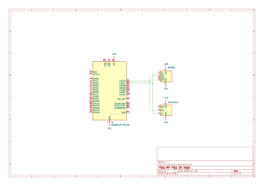
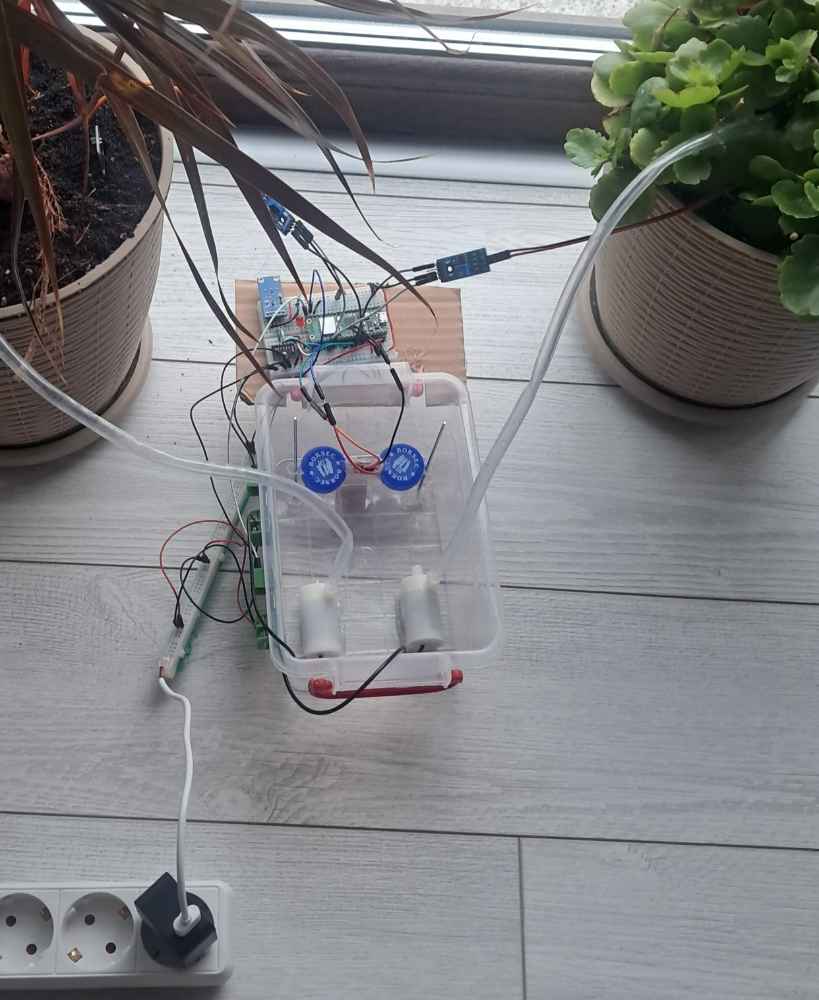

# Raspberry Pi Pico 2W based node
This is the driver for the RP Pico 2W node version. **Up to 2 flowers**

## Node Capabilities
The main limitation of this node is that there are only 3 ADC peripherals onboard. Giving up one for the water level leaves us just 2 for the flowers

| Telemetry       | Hardware                                                                                                 | Interface     |
|-----------------|----------------------------------------------------------------------------------------------------------|---------------|
| Water tank      | Water level sensor (exact level)                                                                         | Analog        |
| Temperature     | [BMP280](https://www.bosch-sensortec.com/media/boschsensortec/downloads/datasheets/bst-bmp280-ds001.pdf) | Digital / I2C |
| Pressure        | [BMP280](https://www.bosch-sensortec.com/media/boschsensortec/downloads/datasheets/bst-bmp280-ds001.pdf) | Digital / I2C | 
| Light Intensity | [BH1750FVI](https://www.alldatasheet.com/datasheet-pdf/view/338083/ROHM/BH1750FVI.html)                  | Digital / I2C |

## Schematics

*Schematic note: GND represents the board ground, GND1 is the power soucre ground*

## Assembly example


## Flashing
### Wi-Fi credentials
Before flashing this node, create the `firmware/secrets/` directory, and provide there the Wi-Fi credentials.
`build.rs` would verify their existance, but not their correctness, so please double-check.
`secrets` should contain 3 files:
1. `ip.txt` => IP address of the backend server within connected network
2. `password.txt` => Wi-Fi password
3. `ssid.txt` => Wi-Fi SSID (network name)

**Hint:** *Use `hostname -I` on Linux to see your IP address on the local network*

### Using the Debug Probe
If you have the debug probe connected just run the following in this directory:
```
cargo run --release
```
It would authomatically flash the board for you

### Using picotool (no debug probe)
This one is a bit more tricky, but very usefull for updating already deployed nodes. 
First of all, you should build the binary:
```
cargo build --release
```
After that, you should locate the compiled binary file at `.target/thumbv8m.main-none-eabihf/release`. 
It would not have any extension, so picotool might not recognize it and throw an error, if you try to load it. Manually add the `.elf` extention to the compiled binary. Connect the USB cable to the board and then connect to your machine while holding the `BOOTSEL` button. Now go back to the terminal and run:
```
picotool load -x ../../../target/thumbv8m.main-none-eabihf/release/rp-pico-2w.elf
```
Alternatively, you can just drag-and-drop the renamed binary to the board.

## Full hardware list
| Qty | Component                   | Clarification     |
|-----|-----------------------------|-------------------|
| 1   | RP Pico 2W                  | N/A               |
| 1   | [BMP280](https://www.bosch-sensortec.com/media/boschsensortec/downloads/datasheets/bst-bmp280-ds001.pdf) | Temperature / Pressure sensor |
| 1   | [BH1750FVI](https://www.alldatasheet.com/datasheet-pdf/view/338083/ROHM/BH1750FVI.html) | Light intensity sensor |
| 1   | Analog water level sensor   | N/A |
| 1   | Water containter            | N/A |
| 2   | Submersible water pump      | N/A |
| 2   | Tube for watering           | N/A |
| 2   | HW548 Mosfet                | Mosfet gates for pumps |
| 2   | N4007 diode                 | Flyback diodes for the pumps |
| 2   | Analog soil moisture sensor | N/A |
| 1   | Red LED                     | Network error indicator |
| 1   | 220 Ohm resistor            | LED protection |
| 1   | Wall => 3V-5V DC adapter    | Power supply for the motors (dev/debug stage), or for entire system (deploy stage) |
| ?   | Wires and breadboard        | N/A |
